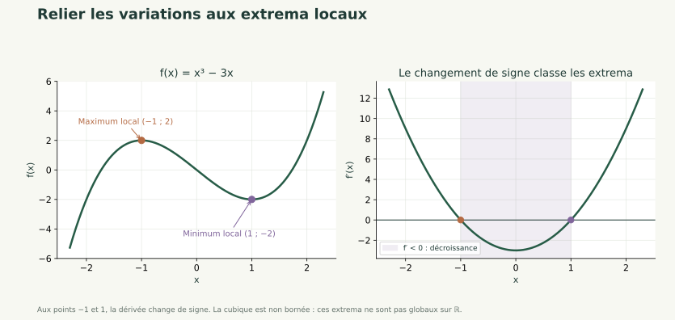
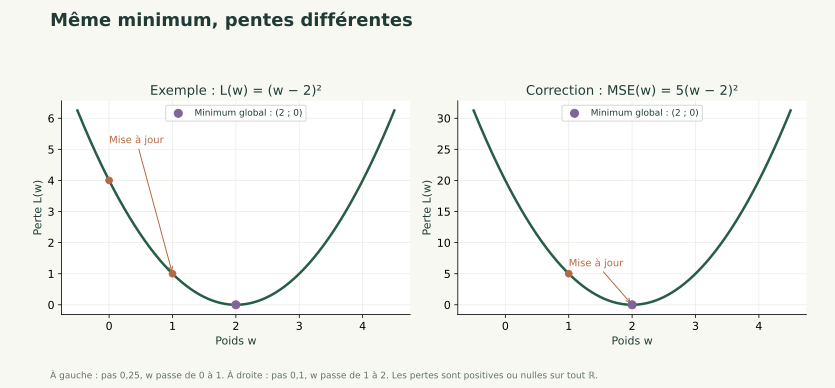
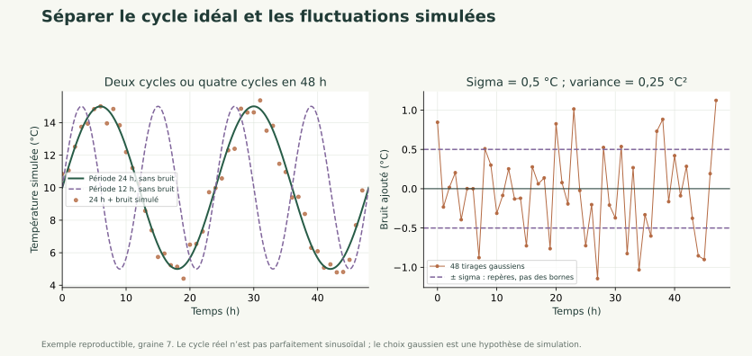

# Décrire les données et dériver une erreur

S1 · Maths B · Antoine

Moyenne, dispersion, dérivée et première amélioration d'un paramètre.

---

## Objectif

Résumer une variable, définir une erreur quadratique et calculer la dérivée d'une perte à un paramètre. Expliquer le sens d'une première mise à jour.

**Prérequis :** Fonction affine, produit matrice-vecteur, carré et moyenne.

---

## Résumé général

Les statistiques décrivent les observations. La perte mesure un écart entre prédictions et cibles. La dérivée indique la variation locale de cette perte lorsqu'un paramètre change ; elle prépare le gradient sans exiger encore toutes les dérivées d'un réseau.

---

## Concepts essentiels — Décrire avant de modéliser

La moyenne est la somme des valeurs divisée par leur nombre. Pour 2, 4 et 6, elle vaut $(2+4+6)/3=4$.

Les écarts à cette moyenne sont -2, 0 et 2. Leur somme est nulle : sommer des erreurs signées peut masquer leur amplitude.

Une statistique décrit le groupe effectivement observé. Un échantillon sélectionné peut mal représenter les journées futures, même s'il contient beaucoup de lignes.

---

## Lecture des formules — Variance descriptive

$$
v=\frac1n\sum_{i=1}^{n}(x_i-\bar x)^2,\qquad s=\sqrt v.
$$

$n$ est le nombre de valeurs, $\bar x$ leur moyenne, $v$ leur variance descriptive et $s$ leur écart-type.

Pour 2, 4 et 6 : $v=(4+0+4)/3=8/3$ et $s=\sqrt{8/3}\approx1{,}633$. L'écart-type retrouve l'unité de la variable ; la variance est dans l'unité au carré.

Cette séance décrit une table donnée avec le diviseur n. La correction n−1 concerne un problème d'estimation expliqué dans le support détaillé ; ne pas mélanger les conventions.

---

## Concepts essentiels — Corrélation et limites

Deux variables peuvent évoluer ensemble. Une corrélation ne prouve pas qu'une variable cause l'autre : une troisième variable ou le choix des observations peut expliquer une partie du lien.

Dans le projet, les valeurs sont simulées et les partitions chronologiques peuvent avoir des températures différentes. Une bonne description de l'apprentissage ne suffit pas à garantir une bonne prédiction future.

Le dossier contient des journées et leurs cibles. Les entrées d'une prévision doivent être disponibles avant la journée à prévoir.

---

## Lecture des formules — Erreur quadratique moyenne

$$
L=\frac1n\sum_i(\widehat y_i-y_i)^2.
$$

$y_i$ est la valeur observée et $\widehat y_i$ la prédiction. On soustrait, on élève au carré, puis on fait la moyenne.

Avec des prédictions 5 et 11 pour des cibles 6 et 10, $L=((-1)^2+1^2)/2=1$. Les erreurs ne s'annulent plus.

Pour une consommation en kWh, cette perte s'exprime en kWh². Elle donne plus de poids aux grandes erreurs et n'est pas un pourcentage d'exactitude.

---

## Explication détaillée — Contrôler la forme des erreurs

Une cible et sa prédiction doivent être comparées observation par observation. Deux vecteurs de forme `(n,)` donnent n erreurs.

NumPy peut cependant diffuser automatiquement des dimensions : soustraire un vecteur `(n,)` à une colonne `(n,1)` produit un tableau `(n,n)`. Chaque prédiction est alors comparée à toutes les cibles, sans déclencher nécessairement une erreur Python.

```python
import numpy as np
p, y = np.array([1., 2., 3.]), np.array([1., 2., 4.])
print((p-y).shape)
print((p[:, None]-y).shape)
```

**Lecture et résultat :** la première soustraction donne `(3,)` ; l'ajout d'un axe par `[:, None]` transforme p en colonne et la seconde donne `(3,3)`. Le code effectue des comparaisons différentes.

Avant une perte, vérifier `predictions.shape == y.shape`. Conserver deux vecteurs ou deux colonnes cohérentes ; ne pas aplatir une matrice quelconque pour masquer une erreur de calcul.

---

## Concepts essentiels — La dérivée d'une fonction

La dérivée donne une pente locale. Pour $f(w)=w^2$, on a $f'(w)=2w$. En w=3, la pente vaut 6 : une petite augmentation de w fait augmenter f à un rythme local voisin de 6 par unité de w.

Pour les fonctions utilisées ici : la dérivée d'une constante vaut 0 ; celle de $aw+b$ vaut a ; celle de $(w-c)^2$ vaut $2(w-c)$.

Le signe renseigne sur une variation locale. La dérivée n'est ni la valeur de la fonction ni une garantie sur un déplacement arbitrairement grand.

---

## Lire un graphique — Minimum local et signe de la dérivée



Pour $f(x)=x^3-3x$, $f'(x)=3x^2-3$. En $x=1$, la dérivée passe de négative à positive : $f(1)=-2$ est un **minimum local**. En $x=-1$, elle passe de positive à négative : $f(-1)=2$ est un **maximum local**.

Local signifie « par rapport aux points voisins ». Ces valeurs ne sont pas des extrema globaux sur $\mathbb{R}$ : la fonction n'est bornée ni au-dessus ni au-dessous. Une dérivée nulle, seule, ne suffit pas à conclure ; par exemple $x^3$ a une tangente horizontale en 0 et reste strictement croissante.

---

## Exemple concret — Réduire une perte

Prenons $L(w)=(w-2)^2$. Alors $L'(w)=2(w-2)$.

En w=0, la perte vaut 4 et la dérivée vaut -4. Pour diminuer la perte, on avance ici vers des w plus grands, dans le sens opposé à la dérivée.

Avec un pas de 0,25 : $w_{nouveau}=0-0{,}25\times(-4)=1$. La perte devient $(1-2)^2=1$.

Le pas contrôle l'amplitude du déplacement. Un pas trop grand peut dépasser la région utile : il faut vérifier l'effet sur la perte.



Ici, le carré reste positif ou nul et vaut zéro en 2 : le minimum est **global**. Le graphe illustre cette propriété ; la forme de la formule la justifie.

---

## Lecture du code — Décrire et faire un premier pas

```python
import numpy as np
valeurs = np.array([2., 4., 6.])
print(valeurs.mean(), valeurs.var(), valeurs.std())
w, pas = 0., .25
gradient = 2 * (w - 2)
w = w - pas * gradient
print(w, (w - 2)**2)
```

**Fonctionnement :** NumPy décrit une série ; le calcul suivant utilise la dérivée analytique d'une perte connue.

**Exécution et résultat :** moyenne 4, variance environ 2,667, écart-type environ 1,633, puis w=1 et perte=1.

**Erreur fréquente :** utiliser la moyenne des erreurs signées comme perte ou ajouter le gradient au lieu de le soustraire.

---

## Algorithme expliqué — Un pas d'amélioration

**Objectif :** réduire une perte à un paramètre. **Entrées :** une valeur initiale, une fonction dérivable, sa dérivée et un pas positif.

**Traitement :** calculer la perte et la dérivée ; soustraire le pas multiplié par la dérivée ; recalculer la perte.

**Sortie :** nouveau paramètre et effet observé. Pour la perte précédente, w passe de 0 à 1 et L de 4 à 1.

Le réseau de la séance suivante sera d'abord étudié comme une fonction de prédiction. Son entraînement complet attendra l'étude de plusieurs paramètres.

---

## Erreurs fréquentes

- Confondre variance descriptive et correction d'estimation.
- Interpréter une corrélation comme une causalité.
- Comparer des prédictions de forme (n,1) avec des cibles de forme (n,) sans contrôle.
- Déduire la qualité du modèle de la seule moyenne signée des erreurs.

---

## Exercice 1 — Décrire une série

**Objectif pédagogique :** Choisir des indicateurs cohérents. **Prérequis :** Moyenne et carrés.

**Énoncé :** Pour les valeurs 1, 3 et 5, calculer moyenne, écarts centrés et variance descriptive.

**Contraintes :** Utiliser le diviseur n et conserver les unités.

**Livrable attendu :** Calculs manuels puis contrôle NumPy.

**Critères de réussite :** Somme des écarts nulle et variance égale à 8/3.

<details><summary>Indices gradués</summary>

1. Commencer par la moyenne.
2. Élever chaque écart au carré avant de moyenner.

</details>

---

## Correction — Décrire une série

<details><summary>Afficher la correction</summary>

La moyenne vaut 3 ; les écarts valent -2, 0 et 2 ; la variance vaut 8/3.

```python
import numpy as np
x = np.array([1., 3., 5.])
print(x.mean(), x - x.mean(), x.var())
```

L'affichage retrouve les calculs. `var()` utilise ici le diviseur n par défaut.

</details>


---

## Exercice 2 — Dériver une perte à un poids

**Objectif pédagogique :** Relier prédiction et dérivation. **Prérequis :** Carré et dérivée de (w-c)².

**Énoncé :** Pour x=(1,3), y=(2,6) et un modèle $\widehat y=wx$, écrire la MSE, la simplifier, la dériver et calculer un pas depuis w=1 avec un pas de 0,1.

**Contraintes :** Faire les calculs avant d'utiliser le code.

**Livrable attendu :** Expression de la perte, dérivée et nouveau poids.

**Critères de réussite :** Les deux observations sont utilisées et le signe de mise à jour est justifié.

<details><summary>Indices gradués</summary>

1. Les résidus valent w−2 et 3(w−2).
2. Factoriser leur somme de carrés.

</details>

---

## Correction — Dériver une perte à un poids

<details><summary>Afficher la correction</summary>

La perte vaut $((w-2)^2+9(w-2)^2)/2=5(w-2)^2$. Sa dérivée est $10(w-2)$. En w=1, L=5 et la dérivée vaut -10. Le nouveau poids est $1-0{,}1(-10)=2$ et la perte devient nulle sur ces deux observations. Cela ne prouve pas une généralisation parfaite.


Le facteur 5 rend la pente cinq fois plus grande, tout en conservant le même minimiseur. Le pas de 0,1 utilisé ici dépend de cette perte précise.

</details>


---

## Exercice 3 — Réparer une fausse mesure d'erreur

**Objectif pédagogique :** Déboguer une perte. **Prérequis :** Tableaux NumPy et moyenne.

**Énoncé :** Le programme calcule `np.mean(predictions - y)` et conclut qu'un résultat nul indique un modèle parfait. Corriger avec predictions=[5,11] et y=[6,10].

**Contraintes :** Contrôler aussi les formes des deux tableaux.

**Livrable attendu :** Fonction correcte et commentaire.

**Critères de réussite :** MSE=1 et distinction entre biais signé et amplitude de l'erreur.

<details><summary>Indices gradués</summary>

1. Les deux erreurs ont des signes opposés.
2. Les carrés empêchent leur annulation.

</details>

---

## Correction — Réparer une fausse mesure d'erreur

<details><summary>Afficher la correction</summary>

Une perte quadratique compare deux vecteurs de même forme.

```python
import numpy as np
predictions, y = np.array([5., 11.]), np.array([6., 10.])
assert predictions.shape == y.shape
print(np.mean(predictions-y), np.mean((predictions-y)**2))
```

La moyenne signée vaut 0, mais la MSE vaut 1. Chaque observation présente une erreur.

</details>


---

## Prolongement — Comprendre une série temporelle simulée

Une température horaire permet de relier fonctions, dispersion et simulation. Ce prolongement prépare une future activité de prédiction ; il ne remplace pas le fil rouge sur la consommation.

```python
import numpy as np
t = np.arange(0., 48., 1.)
np.random.seed(7)
noise = np.random.normal(loc=0.0, scale=0.5, size=t.size)
T_raw = 10 + 5 * np.sin((2*np.pi/24)*t) + noise
```

**À expliquer avant d'ouvrir la correction :** pourquoi $2\pi/24$ ? Que change le remplacement de 24 par 12 ? Pourquoi `scale=0.5` est-il un écart-type, et quelle est la variance du bruit ? Quels rôles jouent 10 et 5 ?

**Lecture et résultat attendu :** 48 instants horaires et 48 températures simulées, de forme `(48,)`. Le signal idéal et les fluctuations sont additionnés ; la graine rend les tirages reproductibles.

[Exercice 5 complet et script de comparaison](../../01_derivation.html) · [TP température et API](../../pratique/Derivation/TPs/02_TP_temperature.html).

---

## Prolongement — Correction et limites de la simulation

<details><summary>Afficher la correction</summary>

Un tour du sinus correspond à $2\pi$ radians. Pour une période $P$, on écrit $\sin(2\pi t/P)$ : après $P$ heures, l'angle a augmenté de $2\pi$. La fréquence vaut $1/P$ cycle/h et la pulsation $2\pi/P$ rad/h. Avec $P=24$ h, il y a deux cycles en 48 h ; avec 12 h, quatre. La fréquence double, mais le niveau central 10 °C et l'amplitude 5 °C restent identiques. Comparer les signaux en réutilisant le même bruit.

`np.random.normal` prend l'écart-type dans `scale` : $\sigma=0{,}5$ °C, donc la variance est $\sigma^2=0{,}25$ °C². `noise.std()` décrit seulement les 48 valeurs tirées et ne vaut généralement pas exactement 0,5. Le bruit n'est pas borné par $\pm0{,}5$. [Documentation NumPy](https://numpy.org/doc/stable/reference/random/generated/numpy.random.normal.html).



Le sinus est une variation quotidienne **idéale** ; le bruit gaussien est une hypothèse pour les fluctuations. Le cycle thermique réel n'est pas parfaitement sinusoïdal. Cette formule culmine à 6 h, sans prétendre reproduire une journée réelle. Un décalage de phase pourrait changer cette heure sans changer la période.

La simulation fabrique des observations selon une règle. Une prédiction estime une valeur inconnue à partir d'informations disponibles. Pour évaluer une prévision future, séparer les données dans l'ordre chronologique et garder le test pour le bilan final.

</details>

---

## Projet fil rouge

### Contexte et utilisateurs

Une équipe de gestion énergétique souhaite comprendre des profils de journées et préparer une prévision. Les 240 journées sont entièrement simulées ; les résultats ne constituent pas une étude de bâtiment réel.

### Problème à résoudre et fonctionnalités cibles

Décrire les caractéristiques d'apprentissage et mesurer la perte d'un modèle linéaire illustratif. Calculer à la main la dérivée d'un petit sous-problème à un seul poids.

### Modèle de données et architecture attendue

Réutiliser `pratique/depart.py`, `pratique/parcours.py` et le même notebook. Les entrées sont température, occupation et équipements. La consommation est la cible, jamais une entrée du classificateur. Les jours 1–144 servent à apprendre, 145–192 à valider, 193–240 au bilan final.

---

## Projet fil rouge — Livrables et validation

### Jalon relié à la séance

Produire un tableau des moyennes et dispersions sur les jours 1–144, une MSE correctement calculée et une mise à jour commentée. À observer : moyenne apprise sur tout le jeu, confusion entre perte et exactitude, erreur de signe dans la dérivée.

### Livrables

Ajouter le code et son commentaire au notebook existant. Conserver les dimensions, les unités, la partition utilisée et les contrôles effectués.

### Critères de validation

Le notebook se relance dans l'ordre. Les calculs manuels concordent avec le code. Les transformations et réglages ne sont jamais appris sur le test. Expliquer les erreurs plutôt que supprimer les observations gênantes.

### Extensions facultatives

Reprendre les supports du [catalogue général](../../index.html) pour approfondir une notion. Les groupes, l'ACP, la SVD et le clustering sont des compléments ; leur étude complète n'est pas nécessaire pour ce parcours court.

---

## Cas d'usage réels

**Organisation :** service de gestion énergétique, scénario pédagogique.

**Problème :** transformer des mesures hétérogènes en une décision interprétable.

**Solution étudiée :** Moyenne, dispersion, dérivée et première amélioration d'un paramètre.

**Bénéfice attendu :** comprendre les hypothèses et contrôler les résultats avant une utilisation sur des données réelles. Une amélioration numérique ne démontre pas une économie d'énergie ni une causalité.

---

## Fiche de révision

- Décrire une table n'est pas encore généraliser.
- La MSE moyenne les carrés des résidus.
- La dérivée décrit une variation locale de la perte.
- Un premier pas doit être contrôlé par un nouveau calcul de perte.

---

## Questions de révision

1. Pourquoi les écarts centrés se somment-ils à zéro ?
2. Dans quelle unité se trouve une MSE ?
3. Pourquoi la dérivée dépend-elle du paramètre courant ?
4. Que fait un pas positif face à une dérivée négative ?
5. Pourquoi faut-il recalculer la perte après la mise à jour ?

---

## QCM — Questions 1 à 2

**1. La moyenne de 2, 4 et 6 vaut**

A. 2 ; B. 4 ; C. 6 ; D. 12.

**2. Des erreurs -1 et 1 ont une MSE de**

A. 0 ; B. 2 ; C. -1 ; D. 1.

<details><summary>Afficher la correction</summary>

1. **B** : la somme 12 est divisée par 3

2. **D** : la moyenne des carrés vaut 1

</details>

---

## QCM — Questions 3 à 5

**3. La dérivée de (w−2)² vaut**

A. 2(w−2) ; B. w−2 ; C. 2 ; D. (w−2)².

**4. Une corrélation élevée démontre**

A. une causalité ; B. une indépendance ; C. une association mesurée dans les données ; D. une prévision parfaite.

**5. La mise à jour de descente utilise**

A. w + pas × gradient ; B. w − pas × gradient ; C. w × perte ; D. la cible comme poids.

<details><summary>Afficher la correction</summary>

3. **A** : la dérivée du carré multiplie par deux son argument

4. **C** : l'association ne suffit pas à prouver la causalité

5. **B** : elle suit la direction opposée au gradient

</details>

---

## Résumé final

Décrire une table n'est pas encore généraliser.
La MSE moyenne les carrés des résidus.
La dérivée décrit une variation locale de la perte.
Un premier pas doit être contrôlé par un nouveau calcul de perte.

[Continuer le parcours](03_comprendre_reseau.md) · [Programme et livrables](programme.md).
