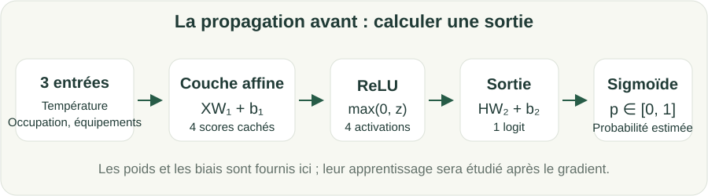

# Du neurone au réseau : la propagation avant

S1 · Michel 1 · Michel

Poids, biais, activations et prédictions avec NumPy, après les statistiques.

---

## Objectif

Expliquer les paramètres d'un réseau, calculer une propagation avant et distinguer cette opération de l'entraînement. Cette introduction suit le bloc « Décrire et interpréter ».

**Prérequis :** Vecteurs, matrices, fonctions, statistiques descriptives et notion de perte. Les chapitres complets d'ACP/SVD et de clustering sont des compléments.

---

## Résumé général

Un neurone combine ses entrées, ajoute un biais et applique une activation. Un réseau compose plusieurs couches. Les poids sont fournis dans cette séance : nous calculons les sorties sans encore coder leur apprentissage. Le gradient et la rétropropagation seront approfondis en semaine 2.

---

## Concepts essentiels — Le neurone

Un neurone calcule d'abord un score $z=x^Tw+b$. Les poids contrôlent la contribution des entrées ; le biais décale le score.

Une activation transforme ce score. Pour une décision binaire, la sigmoïde le convertit en un nombre entre 0 et 1, interprété comme une probabilité estimée.

Les paramètres ne sont pas magiques : leurs valeurs déterminent la fonction calculée. L'apprentissage cherchera ensuite des paramètres utiles sur les données d'apprentissage.

---

## Lecture des formules — Sigmoïde et ReLU

$$
\sigma(z)=\frac1{1+e^{-z}},\qquad \operatorname{ReLU}(z)=\max(0,z).
$$

Dans la sigmoïde, z est le score et e la base de l'exponentielle. Pour z=0, $\sigma(0)=1/2$. Pour un grand score positif, la sortie se rapproche de 1.

ReLU conserve un score positif et remplace un score négatif par 0 : ReLU(-2)=0 et ReLU(3)=3. Sur un tableau, elle agit coordonnée par coordonnée.

Pour notre classificateur, la couche cachée utilise ReLU et la dernière couche produit un score avant sigmoïde, appelé **logit**.

---

## Concepts essentiels — Une couche cachée

Une couche de plusieurs neurones calcule plusieurs combinaisons des mêmes entrées. Le réseau les transforme puis les combine à nouveau.

Une couche cachée avec quatre neurones et trois entrées utilise 12 poids et 4 biais. Une sortie utilisant ces quatre activations ajoute 4 poids et un biais : 21 paramètres au total.

Sans activation non linéaire entre deux couches affines, leur composition reste affine. Ajouter des couches sans non-linéarité ne suffit donc pas à représenter une frontière plus riche.

---

## Explication détaillée — Pourquoi parler de XOR ?

Les entrées (0,0) et (1,1) ont pour classe 0 ; (0,1) et (1,0) ont pour classe 1. Une droite ne peut pas séparer parfaitement ces deux groupes dans le plan.

Ce petit exemple illustre l'intérêt d'une non-linéarité. Ce n'est pas un second projet à entraîner pendant cette séance : le fil rouge reste la consommation.

Un réseau plus expressif peut représenter davantage de fonctions. Cela ne garantit ni un entraînement réussi ni une meilleure généralisation.

---

## Lecture des formules — La propagation avant

Avec les observations en lignes :

$$
H=\operatorname{ReLU}(XW_1+b_1),\quad
z=HW_2+b_2,\quad p=\sigma(z).
$$

Pour n observations, d entrées et h neurones cachés, $W_1$ est de taille $d\times h$, $b_1$ contient h valeurs, $W_2$ est de taille $h\times1$ et $b_2$ est un scalaire.

X et les paramètres produisent H, puis z et enfin p. À ce stade, aucun paramètre n'est mis à jour.

---

## Voir les calculs



---

## Exemple concret — Un réseau calculé à la main

Pour l'entrée $(2,1)$, prenons :

$$
W_1=\begin{pmatrix}1&0\\-1&1\end{pmatrix},\quad b_1=(0,0),\quad
W_2=\begin{pmatrix}1\\2\end{pmatrix},\quad b_2=-3.
$$

La première couche donne $(2-1,1)=(1,1)$, inchangé par ReLU. Le logit vaut $1+2-3=0$, donc la probabilité estimée vaut 0,5.

Avec la règle annoncée « classe 1 si p ≥ 0,5 », la décision est 1. Le seuil et la convention à égalité doivent être explicites.

---

## Lecture du code — Une propagation avant NumPy

```python
import numpy as np
from parcours import passage_numpy
X = np.array([[2., 1.]])
W1, b1 = np.array([[1., 0.], [-1., 1.]]), np.zeros(2)
W2, b2 = np.array([[1.], [2.]]), -3.
H, logits, p = passage_numpy(X, W1, b1, W2, b2)
print(H, logits, p)
```

**Fonctionnement :** les poids et biais sont des entrées fournies à la fonction. Les calculs suivent les trois équations précédentes.

**Exécution et résultat :** H vaut `[[1, 1]]`, le logit `[0]` et la probabilité `[0.5]`.

**Erreur fréquente :** utiliser `np.max` sur la couche entière au lieu de `np.maximum` élément par élément pour ReLU.

---

## Concepts essentiels — Une probabilité n'est pas une décision

Une sortie 0,8 est une probabilité estimée par le modèle, pas une certitude. Le seuil la transforme en décision.

Le choix du seuil dépend de la tâche et des erreurs à éviter. Dans le parcours, il reste fixé à 0,5 pour comparer les modèles simplement.

Dans le fil rouge, la classe « forte consommation » dépend d'un seuil de consommation défini à partir de l'apprentissage. Ce seuil de consommation et le seuil de probabilité 0,5 ont des rôles et des unités différents.

---

## Algorithme expliqué — Construire avant d'entraîner

**Objectif :** vérifier qu'une architecture produit les sorties attendues. **Entrées :** observations et paramètres de dimensions connues.

**Traitement :** calculer une première couche affine ; appliquer ReLU ; calculer le logit ; appliquer la sigmoïde ; convertir en décision avec le seuil fixé.

**Sortie :** une probabilité et une décision par observation. Sur l'exemple, p=0,5 et la décision vaut 1.

Ne pas modifier les poids au hasard pour conclure que le modèle a appris. La semaine suivante reliera une perte, ses dérivées et une mise à jour organisée.

---

## Erreurs fréquentes

- Confondre propagation avant et apprentissage.
- Oublier les biais lors du comptage.
- Transformer une couche entière en un seul maximum.
- Confondre seuil de consommation en kWh et seuil de probabilité.
- Supposer qu'un réseau plus grand est automatiquement meilleur.

---

## Exercice 1 — Lire un neurone

**Objectif pédagogique :** Calculer un score et une probabilité. **Prérequis :** Produit scalaire et sigmoïde.

**Énoncé :** Pour x=(1,2), w=(2,-1) et b=0,5, calculer z, la sigmoïde et la décision au seuil 0,5.

**Contraintes :** Annoncer la règle à égalité.

**Livrable attendu :** Score, probabilité et décision justifiés.

**Critères de réussite :** z=0,5 et décision 1.

<details><summary>Indices gradués</summary>

1. Faire le produit scalaire avant d'ajouter b.
2. La sigmoïde d'un score positif dépasse 0,5.

</details>

---

## Correction — Lire un neurone

<details><summary>Afficher la correction</summary>

Le score vaut $1\times2+2\times(-1)+0{,}5=0{,}5$. La probabilité est environ 0,6225 et la décision est 1.

```python
import numpy as np
from parcours import sigmoide
z = np.array([1., 2.]) @ np.array([2., -1.]) + .5
print(z, sigmoide(z), int(sigmoide(z) >= .5))
```

La sortie retrouve le calcul. Une probabilité de 0,6225 ne garantit pas que la décision soit correcte.

</details>


---

## Exercice 2 — Compter les paramètres

**Objectif pédagogique :** Relier architecture et dimensions. **Prérequis :** Matrices et biais.

**Énoncé :** Un réseau reçoit trois variables, utilise quatre neurones cachés et une sortie. Donner les formes et le nombre total de paramètres.

**Contraintes :** Compter aussi les biais.

**Livrable attendu :** Quatre formes et un total.

**Critères de réussite :** 21 paramètres sans confondre nombre d'observations et nombre d'entrées.

<details><summary>Indices gradués</summary>

1. Un neurone caché reçoit trois poids.
2. La sortie reçoit les quatre activations cachées.

</details>

---

## Correction — Compter les paramètres

<details><summary>Afficher la correction</summary>

W1 : (3,4), b1 : (4,), W2 : (4,1), b2 : un scalaire. Total : 12+4+4+1=21. Le nombre d'observations ne change pas le nombre de paramètres.

</details>


---

## Exercice 3 — Réparer une activation

**Objectif pédagogique :** Déboguer ReLU. **Prérequis :** Tableaux et maximum.

**Énoncé :** Le code utilise `H = np.max(Z1)` avec Z1=[[-1,2],[3,-4]]. Corriger et expliquer pourquoi les dimensions doivent être conservées.

**Contraintes :** Ne pas remplacer le tableau par un scalaire.

**Livrable attendu :** Code corrigé et valeurs de H.

**Critères de réussite :** Une activation par observation et par neurone.

<details><summary>Indices gradués</summary>

1. max réduit ici l'ensemble du tableau.
2. maximum compare deux valeurs à chaque position.

</details>

---

## Correction — Réparer une activation

<details><summary>Afficher la correction</summary>

ReLU applique le maximum avec 0 à chaque case.

```python
import numpy as np
Z1 = np.array([[-1., 2.], [3., -4.]])
H = np.maximum(0., Z1)
assert H.shape == Z1.shape
print(H)
```

On obtient `[[0,2],[3,0]]`. Le réseau conserve deux observations et deux activations par observation.

</details>


---

## Projet fil rouge

### Contexte et utilisateurs

Une équipe de gestion énergétique souhaite comprendre des profils de journées et préparer une prévision. Les 240 journées sont entièrement simulées ; les résultats ne constituent pas une étude de bâtiment réel.

### Problème à résoudre et fonctionnalités cibles

Ajouter une propagation avant à trois entrées et quatre neurones cachés. Les poids sont fixés et explicitement illustratifs ; l'entraînement sera repris avec Michel après le gradient.

### Modèle de données et architecture attendue

Réutiliser `pratique/depart.py`, `pratique/parcours.py` et le même notebook. Les entrées sont température, occupation et équipements. La consommation est la cible, jamais une entrée du classificateur. Les jours 1–144 servent à apprendre, 145–192 à valider, 193–240 au bilan final.

---

## Projet fil rouge — Livrables et validation

### Jalon relié à la séance

Produire 240 logits et probabilités, vérifier les formes et contrôler une ligne à la main. À observer : ReLU réduite en scalaire, double confusion de seuils et consommation fournie comme entrée.

### Livrables

Ajouter le code et son commentaire au notebook existant. Conserver les dimensions, les unités, la partition utilisée et les contrôles effectués.

### Critères de validation

Le notebook se relance dans l'ordre. Les calculs manuels concordent avec le code. Les transformations et réglages ne sont jamais appris sur le test. Expliquer les erreurs plutôt que supprimer les observations gênantes.

### Extensions facultatives

Reprendre les supports du [catalogue général](../../index.html) pour approfondir une notion. Les groupes, l'ACP, la SVD et le clustering sont des compléments ; leur étude complète n'est pas nécessaire pour ce parcours court.

---

## Cas d'usage réels

**Organisation :** service de gestion énergétique, scénario pédagogique.

**Problème :** transformer des mesures hétérogènes en une décision interprétable.

**Solution étudiée :** Poids, biais, activations et prédictions avec NumPy, après les statistiques.

**Bénéfice attendu :** comprendre les hypothèses et contrôler les résultats avant une utilisation sur des données réelles. Une amélioration numérique ne démontre pas une économie d'énergie ni une causalité.

---

## Fiche de révision

- Un réseau compose des opérations sur des vecteurs et des matrices.
- La couche cachée utilise une activation non linéaire.
- Logit, probabilité et décision sont des objets distincts.
- Calculer une propagation avant ne suffit pas à apprendre les paramètres.

---

## Questions de révision

1. À quoi sert une activation non linéaire ?
2. Quelle différence existe entre logit et probabilité ?
3. Pourquoi deux couches affines sans activation restent-elles affines ?
4. Le nombre de paramètres dépend-il du nombre d'observations ?
5. Pourquoi le réseau n'apprend-il rien pendant une propagation avant isolée ?

---

## QCM — Questions 1 à 2

**1. ReLU(-3) vaut**

A. -3 ; B. 3 ; C. 0 ; D. 1.

**2. La sigmoïde de 0 vaut**

A. 0 ; B. 0,5 ; C. 1 ; D. -1.

<details><summary>Afficher la correction</summary>

1. **C** : ReLU remplace les scores négatifs par 0

2. **B** : 1/(1+exp(0)) vaut 1/2

</details>

---

## QCM — Questions 3 à 5

**3. Une propagation avant**

A. calcule les sorties avec des paramètres fournis ; B. choisit toujours les meilleurs poids ; C. sélectionne le test ; D. calcule nécessairement les gradients.

**4. Un réseau 3→4→1 avec biais possède**

A. 12 paramètres ; B. 16 paramètres ; C. 20 paramètres ; D. 21 paramètres.

**5. Sans non-linéarité entre couches affines, leur composition est**

A. toujours constante ; B. toujours quadratique ; C. encore affine ; D. une preuve de causalité.

<details><summary>Afficher la correction</summary>

3. **A** : elle calcule les prédictions

4. **D** : 12+4+4+1=21

5. **C** : la composition de fonctions affines reste affine

</details>

---

## Résumé final

Un réseau compose des opérations sur des vecteurs et des matrices.
La couche cachée utilise une activation non linéaire.
Logit, probabilité et décision sont des objets distincts.
Calculer une propagation avant ne suffit pas à apprendre les paramètres.

[Continuer le parcours](04_preparer_donnees.md) · [Programme et livrables](programme.md).
