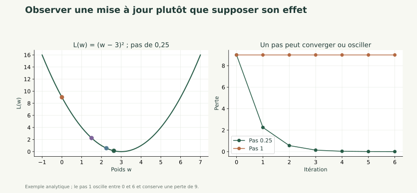

# Optimisation et régularisation

S2 · Maths E · Antoine

Descente, pas, pénalité et sélection des réglages sur validation.

---

## Objectif

Choisir un pas de descente, observer une convergence ou une instabilité et expliquer le rôle d'une pénalité. Préparer la sélection des réglages avant PyTorch.

**Prérequis :** Perte, gradient, règle de chaîne, partitions et standardisation.

---

## Résumé général

Un gradient indique une direction locale ; le pas détermine le déplacement. La régularisation modifie l'objectif optimisé et peut limiter des poids trop grands. Les réglages sont comparés sur validation ; un modèle n'est retenu ni sur sa seule perte d'apprentissage ni sur son test.

---

## Concepts essentiels — Paramètres et réglages

Les poids et biais sont des paramètres ajustés pendant l'apprentissage. Le pas, la pénalité, le nombre de neurones et la règle d'arrêt sont des réglages choisis dans le protocole.

La validation aide à comparer des réglages. Fixer une petite grille avant de regarder les résultats facilite l'interprétation et évite une recherche opportuniste sur le test.

Les expériences utilisent des graines annoncées pour pouvoir être relancées. Une seule graine ne décrit pas toute la variabilité d'un entraînement.

---

## Lecture des formules — Descente de gradient

$$
\theta_{t+1}=\theta_t-\eta\nabla L(\theta_t).
$$

$\theta_t$ contient les paramètres à l'itération t ; $\eta>0$ est le pas. Le gradient est recalculé aux paramètres courants.

Pour $L(w)=(w-3)^2$, le gradient vaut $2(w-3)$. Depuis w=0 et avec un pas de 0,25, le nouveau poids vaut 1,5 et la perte passe de 9 à 2,25.

Cette formule donne une direction locale. Elle ne garantit pas qu'un pas quelconque fasse diminuer une perte non linéaire.

---

## Exemple concret — Trois comportements

Sur la même parabole, un pas de 0,25 produit les poids 0, 1,5, 2,25, 2,625 : ils se rapprochent de 3.

Un pas de 1 produit 0, 6, 0, 6 : on oscille sans se rapprocher du minimum. Un pas de 1,1 s'éloigne du minimum avec des oscillations croissantes.

Un pas très petit peut donner une progression lente. La bonne valeur dépend aussi des échelles des entrées et de la géométrie de la perte.

---

## Voir les calculs



---

## Lecture des formules — Une pénalité L2 explicite

Notre convention est :

$$
L_\lambda=L_{donnees}+\frac\lambda2\sum_j w_j^2.
$$

$\lambda\geq0$ règle la force de la pénalité ; les poids w sont pénalisés, les biais ne le sont pas dans notre réalisation de référence.

La contribution de la pénalité au gradient d'un poids est $\lambda w_j$. Pour w=(1,2) et lambda=0,2, la pénalité vaut 0,5 et sa contribution au gradient vaut (0,2 ; 0,4).

Avec une convention sans facteur 1/2, le gradient aurait un facteur 2 supplémentaire : toujours lire la définition de l'objectif.

---

## Explication détaillée — Apprentissage, validation et arrêt

Une perte d'apprentissage qui baisse pendant que la perte de validation remonte peut signaler un surapprentissage. Il faut examiner les courbes et les distributions, pas une seule valeur.

On peut conserver une copie des paramètres obtenus à la meilleure perte de validation. Une règle de patience arrête ensuite l'entraînement si cette perte n'améliore plus son meilleur niveau.

Restaurer les meilleurs paramètres est indispensable : la dernière itération n'est pas nécessairement celle choisie par la règle.

---

## Lecture du code — Observer une descente

```python
w, pas = 0., .25
historique = [w]
for _ in range(3):
    gradient = 2*(w-3)
    w -= pas*gradient
    historique.append(w)
print(historique)
print([(v-3)**2 for v in historique])
```

**Fonctionnement :** la boucle recalcule la dérivée avant chaque mise à jour et mémorise les valeurs.

**Résultat :** poids `[0,1.5,2.25,2.625]`, pertes `[9,2.25,0.5625,0.140625]`.

**Erreur fréquente :** ajouter le gradient ou réutiliser indéfiniment le gradient du point initial.

---

## Concepts essentiels — Lots et coût de calcul

Une époque correspond à un parcours des données d'apprentissage. Une itération correspond à une mise à jour ; avec des mini-lots, plusieurs itérations peuvent appartenir à une même époque.

Notre petit jeu permet de calculer le gradient sur les 144 journées à chaque itération. Cette version en lot complet facilite la lecture et la reproductibilité.

Les mini-lots sont une extension utile pour des jeux plus grands. Ils ne changent pas la séparation entre propagation avant, calcul de gradients et mise à jour.

---

## Algorithme expliqué — Choisir sans consulter le test

**Objectif :** sélectionner un réglage et une itération. **Entrées :** train, validation et une grille fixée.

**Traitement :** entraîner chaque candidat sur train ; suivre la perte de validation ; garder une copie de son meilleur état ; comparer les candidats sur validation ; figer les choix.

**Sortie :** paramètres et réglages sélectionnés. Si les pertes de validation de deux candidats sont 0,35 et 0,42, la règle annoncée retient le premier.

Le test n'intervient qu'après cette sélection. Une régularisation plus forte ne garantit pas une meilleure performance.

---

## Erreurs fréquentes

- Assimiler un petit coût d'apprentissage à une bonne généralisation.
- Choisir un pas sur le test.
- Confondre époque et itération.
- Oublier de restaurer le meilleur état de validation.
- Changer la convention de pénalité sans adapter le gradient.

---

## Exercice 1 — Comparer deux pas

**Objectif pédagogique :** Identifier convergence et oscillation. **Prérequis :** Dérivée d'une parabole.

**Énoncé :** Pour L(w)=(w−3)² depuis w=0, calculer trois mises à jour avec les pas 0,25 puis 1.

**Contraintes :** Calculer les pertes et ne pas conclure à partir du seul signe du gradient.

**Livrable attendu :** Deux trajectoires commentées.

**Critères de réussite :** Convergence vers 3 dans le premier cas et oscillation 0↔6 dans le second.

<details><summary>Indices gradués</summary>

1. Recalculer 2(w−3) après chaque mise à jour.
2. Comparer les distances à 3.

</details>

---

## Correction — Comparer deux pas

<details><summary>Afficher la correction</summary>

Pas 0,25 : poids 0→1,5→2,25→2,625 ; pertes 9→2,25→0,5625→0,140625. Pas 1 : 0→6→0→6 ; la perte reste 9. Sur cette fonction, le second pas ne produit aucune convergence.

</details>


---

## Exercice 2 — Ajouter la contribution L2

**Objectif pédagogique :** Respecter une convention de pénalité. **Prérequis :** Gradient et carré.

**Énoncé :** Le gradient des données vaut (3,4), les poids valent (1,2) et lambda=0,2. Ajouter le gradient de la pénalité lambda||w||²/2 et calculer cette pénalité.

**Contraintes :** Ne pas pénaliser le biais et ne pas ajouter un facteur 2 absent de la convention.

**Livrable attendu :** Gradient total et valeur de la pénalité.

**Critères de réussite :** Gradient (3,2 ; 4,4) et pénalité 0,5.

<details><summary>Indices gradués</summary>

1. La dérivée de lambda × w²/2 est lambda × w.
2. Ajouter les contributions composante par composante.

</details>

---

## Correction — Ajouter la contribution L2

<details><summary>Afficher la correction</summary>

Le gradient total est (3,4)+0,2(1,2)=(3,2 ; 4,4). La pénalité vaut 0,2/2×(1+4)=0,5.

```python
import numpy as np
w, gradient_donnees, penalite = np.array([1., 2.]), np.array([3., 4.]), .2
print(gradient_donnees + penalite*w, penalite/2 * (w @ w))
```

La valeur du coût et son gradient ont des rôles différents : on ne soustrait pas directement la pénalité scalaire à chaque poids.

</details>


---

## Exercice 3 — Réparer une descente qui monte

**Objectif pédagogique :** Déboguer une mise à jour. **Prérequis :** Gradient et sens de variation.

**Énoncé :** Pour la perte (w−3)², un code met à jour `w += pas * gradient`. Corriger et montrer l'effet du premier pas depuis w=0 avec pas=0,25.

**Contraintes :** Comparer les pertes avant et après.

**Livrable attendu :** Code corrigé et diagnostic.

**Critères de réussite :** Le poids passe à 1,5 et la perte diminue à 2,25.

<details><summary>Indices gradués</summary>

1. Le gradient initial vaut -6.
2. La descente suit l'opposé du gradient.

</details>

---

## Correction — Réparer une descente qui monte

<details><summary>Afficher la correction</summary>

Le signe doit être négatif.

```python
w, pas = 0., .25
avant = (w-3)**2
w -= pas * (2*(w-3))
print(avant, w, (w-3)**2)
```

La sortie est `9.0 1.5 2.25`. Le code initial aurait donné w=-1,5 et une perte de 20,25.

</details>


---

## Projet fil rouge

### Contexte et utilisateurs

Une équipe de gestion énergétique souhaite comprendre des profils de journées et préparer une prévision. Les 240 journées sont entièrement simulées ; les résultats ne constituent pas une étude de bâtiment réel.

### Problème à résoudre et fonctionnalités cibles

Annoncer la grille des réglages, les graines et la règle d'arrêt que Michel réutilisera pour l'entraînement PyTorch. Comparer une descente simple à ses contrôles analytiques.

### Modèle de données et architecture attendue

Réutiliser `pratique/depart.py`, `pratique/parcours.py` et le même notebook. Les entrées sont température, occupation et équipements. La consommation est la cible, jamais une entrée du classificateur. Les jours 1–144 servent à apprendre, 145–192 à valider, 193–240 au bilan final.

---

## Projet fil rouge — Livrables et validation

### Jalon relié à la séance

Produire une trajectoire de perte, un contrôle du signe de mise à jour et une fiche de protocole. À observer : réglage choisi sur test, convention L2 non annoncée et meilleurs poids non restaurés.

### Livrables

Ajouter le code et son commentaire au notebook existant. Conserver les dimensions, les unités, la partition utilisée et les contrôles effectués.

### Critères de validation

Le notebook se relance dans l'ordre. Les calculs manuels concordent avec le code. Les transformations et réglages ne sont jamais appris sur le test. Expliquer les erreurs plutôt que supprimer les observations gênantes.

### Extensions facultatives

Reprendre les supports du [catalogue général](../../index.html) pour approfondir une notion. Les groupes, l'ACP, la SVD et le clustering sont des compléments ; leur étude complète n'est pas nécessaire pour ce parcours court.

---

## Cas d'usage réels

**Organisation :** service de gestion énergétique, scénario pédagogique.

**Problème :** transformer des mesures hétérogènes en une décision interprétable.

**Solution étudiée :** Descente, pas, pénalité et sélection des réglages sur validation.

**Bénéfice attendu :** comprendre les hypothèses et contrôler les résultats avant une utilisation sur des données réelles. Une amélioration numérique ne démontre pas une économie d'énergie ni une causalité.

---

## Fiche de révision

- La descente recalcule le gradient aux paramètres courants.
- Le pas peut produire convergence, lenteur ou instabilité.
- La pénalité doit avoir une convention explicite.
- Les réglages et l'arrêt sont choisis sur validation, avant le test.

---

## Questions de révision

1. Pourquoi un pas trop grand peut-il faire monter la perte ?
2. Quelle différence existe entre paramètres et réglages ?
3. Pourquoi copier les meilleurs poids ?
4. Quelle contribution L2 ajoute notre convention au gradient ?
5. Le lot complet et les mini-lots ont-ils le même nombre d'itérations par époque ?

---

## QCM — Questions 1 à 2

**1. Le pas règle**

A. l'amplitude du déplacement ; B. le nombre de classes ; C. l'unité de la cible ; D. la partition test.

**2. Une perte de validation qui remonte peut signaler**

A. une garantie de convergence ; B. un surapprentissage ; C. une preuve de causalité ; D. une absence de biais.

<details><summary>Afficher la correction</summary>

1. **A** : il multiplie le gradient dans la mise à jour

2. **B** : elle peut révéler une dégradation hors apprentissage

</details>

---

## QCM — Questions 3 à 5

**3. Pour lambda||w||²/2, le gradient ajouté est**

A. lambda ; B. 2lambda ; C. lambda × w ; D. la perte entière.

**4. Le meilleur état se choisit ici sur**

A. le test ; B. la taille du fichier ; C. la dernière itération systématiquement ; D. la validation.

**5. Une pénalité plus forte**

A. améliore toujours le test ; B. peut aussi trop contraindre le modèle ; C. supprime les données ; D. ne change jamais les poids.

<details><summary>Afficher la correction</summary>

3. **C** : la dérivée du carré annule le facteur 1/2

4. **D** : cette règle est fixée avant le bilan test

5. **B** : elle peut conduire à un sous-apprentissage

</details>

---

## Résumé final

La descente recalcule le gradient aux paramètres courants.
Le pas peut produire convergence, lenteur ou instabilité.
La pénalité doit avoir une convention explicite.
Les réglages et l'arrêt sont choisis sur validation, avant le test.

[Continuer le parcours](07_entrainer_pytorch.md) · [Programme et livrables](programme.md).
