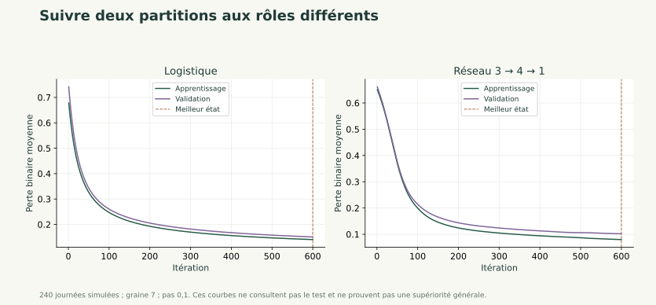

# Évaluer et argumenter la généralisation

Évaluation

Courbes, matrice de confusion, références simples et bilan final.

---

## Objectif

Évaluer des modèles figés, interpréter les erreurs et rédiger une conclusion sur la généralisation. Comparer le réseau à une référence majoritaire et à une logistique.

**Prérequis :** Classification binaire, probabilités, partitions et entraînement avec validation.

---

## Résumé général

Une perte d'apprentissage faible ne suffit pas à établir une performance hors apprentissage. Le protocole fige les choix avant le test. Une matrice de confusion détaille les erreurs et évite de résumer toutes les situations par une seule exactitude.

---

## Concepts essentiels — Trois modèles à comparer

La référence majoritaire prédit toujours la classe la plus fréquente dans l'apprentissage. Elle vérifie si un modèle complexe apporte quelque chose par rapport à une décision très simple.

La logistique calcule un score affine puis une probabilité. Le réseau ajoute une couche cachée non linéaire. Les mêmes partitions, transformations, classes et seuils de décision permettent une comparaison lisible.

Le réseau n'est pas tenu de gagner. Une performance équivalente ou inférieure peut justifier le modèle plus simple, selon les besoins et les limites de l'évaluation.

---

## Lecture des formules — La matrice de confusion

Les lignes représentent la classe réelle et les colonnes la classe prédite, dans l'ordre 0 puis 1 :

$$
C=\begin{pmatrix}TN&FP\\FN&TP\end{pmatrix}.
$$

TN : négatifs correctement prédits ; FP : fausses alertes ; FN : positifs manqués ; TP : positifs correctement prédits.

Avec les vraies classes (0,0,1,1) et les décisions (0,1,1,0), chaque case vaut 1. La convention des lignes et colonnes doit être écrite pour éviter une lecture inversée.

---

## Lecture des formules — Exactitude, précision et rappel

$$
exactitude=\frac{TP+TN}{n},\quad
precision=\frac{TP}{TP+FP},\quad
rappel=\frac{TP}{TP+FN}.
$$

L'exactitude compte toutes les bonnes décisions. La précision demande quelle part des alertes est correcte ; le rappel demande quelle part des positifs réels a été retrouvée.

Dans l'exemple à quatre observations, les trois indicateurs valent 0,5. Si aucune alerte n'est prédite, la précision n'est pas définie ; notre code renvoie `None` pour le signaler.

---

## Exemple concret — Une exactitude trompeuse

Sur 100 observations dont 90 négatives et 10 positives, toujours prédire 0 donne 90 % d'exactitude. Le rappel des positifs est pourtant nul.

Pour une tâche d'alerte, manquer tous les positifs peut être inacceptable. Il faut choisir les indicateurs selon la question, en conservant les effectifs et les coûts des erreurs.

Dans notre petit test de 48 journées, une seule décision modifie l'exactitude d'environ 2,08 points de pourcentage. Un petit écart entre modèles ne permet pas une affirmation générale sur tous les bâtiments.

---

## Explication détaillée — Lire les courbes

Une courbe d'apprentissage décrit l'ajustement aux données utilisées pour les gradients. La courbe de validation renseigne sur des observations qui ne servent pas directement à ces mises à jour.

Si train baisse alors que validation remonte, examiner un surapprentissage possible, la capacité, la pénalité et les changements de distribution. Si les deux restent élevées, examiner aussi la représentation, l'optimisation et un modèle trop limité.

La validation est utilisée pour choisir ; elle n'est donc pas un bilan totalement indépendant. Le test final conserve ce rôle dans le protocole.

---

## Voir les calculs



---

## Lecture du code — Compter les erreurs

```python
import numpy as np
from parcours import metriques
classes = np.array([0, 0, 1, 1])
p = np.array([.1, .8, .7, .4])
rapport = metriques(classes, p >= .5)
print(rapport)
```

**Fonctionnement :** le seuil transforme les probabilités en décisions, puis le compteur place chaque observation dans une case.

**Résultat :** matrice `[[1,1],[1,1]]`, exactitude, précision et rappel égaux à 0,5.

**Erreur fréquente :** compter FP et FN à l'envers ou ne pas vérifier quelle classe désigne « positif ».

---

## Concepts essentiels — Figer avant le bilan

Figer signifie conserver l'ordre des colonnes, les échelles, le seuil de consommation, le seuil de probabilité, l'architecture et les paramètres choisis.

Le code `experience` annonce sa grille, sélectionne une logistique et un réseau sur validation, puis évalue les deux modèles figés et la référence majoritaire sur test.

Comparer ces modèles prévus au bilan est autorisé. Choisir ensuite un nouveau réglage en fonction de ce test et présenter le même test comme indépendant ne l'est plus. Une nouvelle phase de choix demanderait un nouveau protocole d'évaluation.

---

## Algorithme expliqué — Rédiger un bilan utile

**Objectif :** expliquer ce que les résultats permettent de conclure. **Entrées :** modèles figés, données test et protocole documenté.

**Traitement :** produire les décisions ; calculer les effectifs et métriques ; comparer aux références ; examiner des erreurs ; distinguer constats, hypothèses et limites.

**Sortie :** un notebook relançable et une conclusion argumentée. Exemple : « le réseau réduit certains faux négatifs sur ce test, mais augmente les fausses alertes ; l'effectif et la saisonnalité ne permettent pas de conclure à une supériorité générale ».

Une conclusion peut aussi retenir la logistique. La complexité du modèle n'est pas un objectif à elle seule.

---

## Erreurs fréquentes

- Ne regarder que l'exactitude sur des classes déséquilibrées.
- Inverser FP et FN.
- Choisir un réglage sur le test puis prétendre à une indépendance.
- Assimiler un faible écart sur 48 journées à un résultat universel.
- Exiger que le réseau gagne pour considérer le travail réussi.

---

## Exercice 1 — Lire une matrice de confusion

**Objectif pédagogique :** Relier décisions et indicateurs. **Prérequis :** Classes binaires et proportions.

**Énoncé :** Pour classes=(0,0,1,1) et décisions=(0,1,1,0), construire la matrice et calculer exactitude, précision et rappel.

**Contraintes :** Écrire la convention lignes/colonnes.

**Livrable attendu :** Matrice et trois indicateurs expliqués.

**Critères de réussite :** Chaque case vaut 1 et les trois indicateurs valent 0,5.

<details><summary>Indices gradués</summary>

1. Classer chaque observation une par une.
2. Le dénominateur de précision compte les alertes prédites.

</details>

---

## Correction — Lire une matrice de confusion

<details><summary>Afficher la correction</summary>

La première observation est TN, la deuxième FP, la troisième TP et la quatrième FN. Avec les classes réelles en lignes, la matrice vaut [[1,1],[1,1]]. Exactitude=2/4, précision=1/2 et rappel=1/2.

</details>


---

## Exercice 2 — Changer le seuil sur validation

**Objectif pédagogique :** Comprendre le compromis entre erreurs. **Prérequis :** Probabilités et matrice de confusion.

**Énoncé :** Sur validation, classes=(0,0,1,1) et probabilités=(0,1 ; 0,8 ; 0,7 ; 0,4). Comparer les seuils 0,5 et 0,3. Quel compromis change ?

**Contraintes :** Ne pas sélectionner le seuil sur le test final.

**Livrable attendu :** Deux matrices et une justification liée à la tâche.

**Critères de réussite :** Au seuil 0,3, rappel=1 et précision=2/3 ; aucune supériorité universelle annoncée.

<details><summary>Indices gradués</summary>

1. La dernière observation change de décision.
2. Comparer les positifs manqués et les fausses alertes.

</details>

---

## Correction — Changer le seuil sur validation

<details><summary>Afficher la correction</summary>

Le seuil 0,3 retrouve les deux positifs et conserve une fausse alerte.

```python
import numpy as np
from parcours import metriques
y, p = np.array([0, 0, 1, 1]), np.array([.1, .8, .7, .4])
print(metriques(y, p >= .5))
print(metriques(y, p >= .3))
```

La seconde matrice est [[1,1],[0,2]], avec exactitude 0,75, précision 2/3 et rappel 1. Le choix reste lié au coût des erreurs et à un protocole fixé.

</details>


---

## Exercice 3 — Réparer une sélection sur test

**Objectif pédagogique :** Identifier une conclusion invalide. **Prérequis :** Séparation des rôles des partitions.

**Énoncé :** Un groupe essaie dix taux d'apprentissage, retient celui qui maximise l'exactitude test, puis affirme avoir une mesure indépendante. Corriger le protocole et proposer une conclusion honnête si ce test a déjà été consulté.

**Contraintes :** Ne pas rebaptiser les données pour effacer leur utilisation.

**Livrable attendu :** Protocole corrigé et limite reconnue.

**Critères de réussite :** Réglages choisis sur validation ; ancien test reconnu comme utilisé pour les choix.

<details><summary>Indices gradués</summary>

1. Quelles données ont servi à sélectionner ?
2. Un test utilisé pour choisir ne redevient pas indépendant par changement de nom.

</details>

---

## Correction — Réparer une sélection sur test

<details><summary>Afficher la correction</summary>

Avant les expériences, fixer train/validation/test. Comparer les dix taux sur validation, restaurer les meilleurs poids, puis consulter le test. Si le test a déjà servi à choisir, le résultat doit être présenté comme exploratoire ; une mesure indépendante nécessite des données réservées ou un nouveau protocole adapté.

</details>


---

## Projet fil rouge

### Contexte et utilisateurs

Une équipe de gestion énergétique souhaite comprendre des profils de journées et préparer une prévision. Les 240 journées sont entièrement simulées ; les résultats ne constituent pas une étude de bâtiment réel.

### Problème à résoudre et fonctionnalités cibles

Finaliser le même notebook : courbes, choix de validation, références, bilan test et explication des erreurs. Présenter oralement une décision de protocole et une limite.

### Modèle de données et architecture attendue

Réutiliser `pratique/depart.py`, `pratique/parcours.py` et le même notebook. Les entrées sont température, occupation et équipements. La consommation est la cible, jamais une entrée du classificateur. Les jours 1–144 servent à apprendre, 145–192 à valider, 193–240 au bilan final.

---

## Projet fil rouge — Livrables et validation

### Jalon relié à la séance

Rendre un tableau comparable pour la majorité, la logistique et le réseau, les matrices de confusion et une conclusion. Vérifier que le test n'a choisi aucun réglage. À observer : réseau déclaré meilleur par principe, métriques sans effectifs et transformation oubliée.

### Livrables

Ajouter le code et son commentaire au notebook existant. Conserver les dimensions, les unités, la partition utilisée et les contrôles effectués.

### Critères de validation

Le notebook se relance dans l'ordre. Les calculs manuels concordent avec le code. Les transformations et réglages ne sont jamais appris sur le test. Expliquer les erreurs plutôt que supprimer les observations gênantes.

### Extensions facultatives

Reprendre les supports du [catalogue général](../../index.html) pour approfondir une notion. Les groupes, l'ACP, la SVD et le clustering sont des compléments ; leur étude complète n'est pas nécessaire pour ce parcours court.

---

## Cas d'usage réels

**Organisation :** service de gestion énergétique, scénario pédagogique.

**Problème :** transformer des mesures hétérogènes en une décision interprétable.

**Solution étudiée :** Courbes, matrice de confusion, références simples et bilan final.

**Bénéfice attendu :** comprendre les hypothèses et contrôler les résultats avant une utilisation sur des données réelles. Une amélioration numérique ne démontre pas une économie d'énergie ni une causalité.

---

## Fiche de révision

- Les métriques décrivent des erreurs différentes.
- Les références simples donnent un point de comparaison.
- Les choix sont figés avant le bilan test.
- La conclusion doit conserver les limites du jeu simulé et des effectifs.

---

## Questions de révision

1. Que mesure le rappel ?
2. Pourquoi faut-il afficher les effectifs des classes ?
3. Quel rôle joue la référence majoritaire ?
4. Quand une précision est-elle indéfinie ?
5. Qu'est-ce qui doit être figé avant le test ?

---

## QCM — Questions 1 à 2

**1. Un faux négatif est**

A. un négatif prédit positif ; B. un positif prédit négatif ; C. un positif correctement prédit ; D. une probabilité nulle.

**2. La référence majoritaire utilise la majorité de**

A. l'apprentissage ; B. chaque requête ; C. tous les tests futurs ; D. la dernière ligne.

<details><summary>Afficher la correction</summary>

1. **B** : le positif réel est manqué

2. **A** : sa règle est fixée sans apprendre la distribution du test

</details>

---

## QCM — Questions 3 à 5

**3. Une bonne exactitude sur des classes déséquilibrées**

A. garantit un bon rappel ; B. garantit une bonne précision ; C. peut masquer des positifs manqués ; D. rend la matrice inutile.

**4. Après consultation du test pour choisir un réglage, ce test**

A. devient plus fiable ; B. est toujours indépendant ; C. prouve la causalité ; D. a participé à la sélection.

**5. Le réseau doit-il nécessairement battre la logistique ?**

A. oui ; B. non ; C. si le notebook est long ; D. si ses poids sont nombreux.

<details><summary>Afficher la correction</summary>

3. **C** : le grand groupe peut dominer cet indicateur

4. **D** : son rôle a changé

5. **B** : les modèles sont jugés sur le protocole et les résultats, pas sur leur complexité

</details>

---

## Résumé final

Les métriques décrivent des erreurs différentes.
Les références simples donnent un point de comparaison.
Les choix sont figés avant le bilan test.
La conclusion doit conserver les limites du jeu simulé et des effectifs.

[Revenir au parcours](../index.html).
