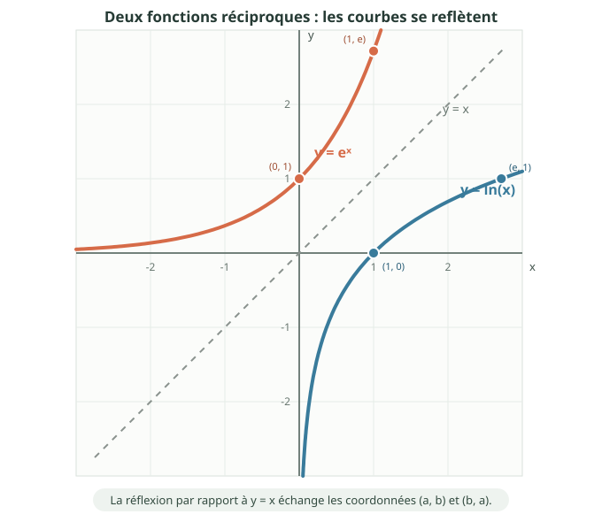

# Révision d’algèbre : calculs essentiels


---

# Pourquoi faire des maths ? Calculer plus simplement

Dans une boutique, comparons deux paniers :

| Panier | Nombre de produits | Prix par produit | Total à calculer |
|---|---|---|---|
| A | 3 | 50 € | $3 \times 50$ |
| B | 50 | 3 € | $50 \times 3$ |

Pour le panier A, on peut additionner $50 + 50 + 50$.

Pour le panier B, on pourrait additionner 3 cinquante fois. Mais est-il nécessaire de faire toutes ces additions ?

**Avant de calculer :** quelle écriture vous permet de trouver le total le plus facilement ?

---

# Trois fois 50 ou cinquante fois 3 ?

$$
\underbrace{50+50+50}_{3\text{ fois}}=150
\qquad
\underbrace{3+3+\cdots+3}_{50\text{ fois}}=150.
$$

La **commutativité de la multiplication des nombres** permet d'échanger les facteurs :

$$
3\times50=50\times3=150.
$$

Les deux paniers contiennent des quantités différentes, mais coûtent chacun **150 €**.

Si l'on procède par additions successives, la première écriture demande 2 additions ; la seconde, 49. Reconnaître l'égalité évite ce travail répétitif.

**Les maths aident aussi à choisir un chemin de calcul plus court, tout en gardant un résultat exact.**

---

# 1. Priorités de calcul

Ordre des opérations (toujours dans cet ordre) :

1. Parenthèses
2. Puissances et racines
3. Multiplications et divisions
4. Additions et soustractions

Exemple :

$$
3 + 2 \cdot 5^2 = 3 + 2 \cdot 25 = 3 + 50 = 53.
$$

---

# À vous · Quatre calculs algébriques

Sans calculatrice, simplifiez chaque expression et justifiez les transformations.

1. **Réduire :** $5x-3+2x+8$.
2. **Développer et réduire :** $3(2x-5)-2(x+1)$.
3. **Factoriser :** $6x^2+9x$.
4. **Simplifier :** $\dfrac{x^2-9}{x-3}$, en précisant la valeur interdite.

<details hidden class="public-correction"><summary>Afficher la correction</summary>

1. $5x-3+2x+8=7x+5$.
2. $3(2x-5)-2(x+1)=6x-15-2x-2=4x-17$.
3. $6x^2+9x=3x(2x+3)$.
4. $\dfrac{x^2-9}{x-3}=\dfrac{(x-3)(x+3)}{x-3}=x+3$, pour $x\ne3$. La simplification ne rend pas l'expression initiale définie en $x=3$.

</details>

---

# 2. Développer

Règle de base :

$$
(a+b)(c+d)=ac + ad + bc + bd.
$$

Cas particuliers importants :

### Cas 1 : carré d’une somme

$$
(a+b)^2 = a^2 + 2ab + b^2.
$$

### Cas 2 : carré d’une différence

$$
(a-b)^2 = a^2 - 2ab + b^2.
$$

---

### Cas 3 : produit conjugué

$$
(a-b)(a+b)=a^2 - b^2.
$$

Exemple :

$$
(3x - 2)(x + 5) = 3x^2 + 15x - 2x - 10.
$$

$$
= 3x^2 + 13x - 10.
$$

---

# 3. Factoriser

Objectif : réécrire un terme sous forme de produit.

Méthodes principales :

### 1. Mise en évidence

$$
3x^2 - 6x = 3x(x - 2).
$$

### 2. Identités remarquables

$$
x^2 - 4 = (x-2)(x+2).
$$

$$
9x^2 - 6x + 1 = (3x - 1)^2.
$$

---

### 3. Factorisation par regroupement

$$
x^3 + x^2 + x + 1 = (x^2 + 1)(x + 1).
$$

---

# Démo 2 · La somme de deux entiers pairs est paire

**Objectif :** utiliser la factorisation pour passer des exemples à une preuve générale, puis traduire cette preuve dans Lean.

Un entier $a \in \mathbb{Z}$ est **pair** s'il existe un entier $k$ tel que $a = 2k$. Cela inclut 0 et les entiers négatifs.

Exemple : $14 + 22 = 36 = 2 \times 18$.

Cet exemple vérifie un cas. Pour démontrer l'énoncé, il faut raisonner sur **deux entiers pairs quelconques**, sans leur attribuer des valeurs particulières.

**Prérequis :** mise en facteur commun et sens du mot « entier ».

---

# À faire · Construire la preuve sur papier

On suppose $a = 2k$ et $b = 2\ell$, avec $k,\ell \in \mathbb{Z}$.

1. Remplacer $a$ et $b$ dans $a+b$.
2. Mettre 2 en facteur.
3. Quel entier joue le rôle du « double de quelque chose » pour $a+b$ ?
4. Pourquoi le raisonnement fonctionne-t-il aussi si $a$ ou $b$ est négatif ?

**Livrable :** trois lignes de calcul et une phrase de conclusion. Ne pas supposer que $k = \ell$ : les deux entiers pairs peuvent être différents.

<details><summary>Indice · Choisir un témoin</summary>

Un **témoin** est ici l'entier qui rend vraie l'écriture « $a+b = 2 \times$ un entier ». Utiliser la règle $2k + 2\ell = 2(k+\ell)$.

</details>

<details hidden class="public-correction"><summary>Correction · Une preuve pour tous les entiers</summary>

Comme $a$ et $b$ sont pairs, il existe $k,\ell \in \mathbb{Z}$ tels que $a=2k$ et $b=2\ell$. Alors :

$$
a+b = 2k + 2\ell = 2(k+\ell).
$$

La somme $k+\ell$ est un entier. Elle fournit donc le témoin qui prouve que $a+b$ est pair.

Le raisonnement ne suppose aucun signe : par exemple $-6 + 10 = 2(-3 + 5) = 4$.

</details>

---

# Traduire l'énoncé dans Lean

**Lean est un assistant de preuve :** il vérifie les étapes d'une démonstration formelle. Ici, on utilise Lean 4 avec la bibliothèque mathématique **Mathlib**.

| Écriture | Lecture |
| --- | --- |
| `a b : ℤ` | `a` et `b` sont des entiers relatifs. |
| `ha : Even a` | `ha` est l'hypothèse « `a` est pair ». |
| `hb : Even b` | `hb` est l'hypothèse « `b` est pair ». |
| `Even (a + b)` | C'est la conclusion à démontrer. |

Dans Mathlib, `Even a` signifie qu'il existe un entier `k` tel que **`a = k + k`**. C'est la même notion que $a = 2k$ ; la bibliothèque l'écrit sous forme d'addition.

On cherche donc un témoin pour écrire `a + b = (k + l) + (k + l)`.

[Définition officielle de `Even`](https://leanprover-community.github.io/mathlib4_docs/Mathlib/Algebra/Group/Even.html#Even).

---

# À faire · Formaliser la preuve en Lean

Dans un environnement **Lean 4 avec Mathlib**, retrouver les deux témoins, choisir leur somme, puis vérifier l'égalité obtenue.

**Livrable :** une preuve acceptée par Lean, sans `sorry` ni ajout d'axiome. `sorry` est un trou de preuve : un fichier accepté avec cet avertissement ne suffit pas à terminer la démonstration.

<details hidden class="public-correction"><summary>Correction · Le fichier Lean complet</summary>

```lean
import Mathlib

theorem somme_de_deux_pairs (a b : ℤ)
    (ha : Even a) (hb : Even b) : Even (a + b) := by
  rcases ha with ⟨k, hk⟩
  rcases hb with ⟨l, hl⟩
  refine ⟨k + l, ?_⟩
  rw [hk, hl]
  ring
```

Le témoin proposé est `k + l`. Après remplacement de `a` et `b`, il reste à vérifier l'identité `(k + k) + (l + l) = (k + l) + (k + l)`.

</details>

[Télécharger le fichier Lean](exemples/revision/somme_pairs.lean) · [Ouvrir un éditeur Lean en ligne](https://live.lean-lang.org/) ; utiliser un projet disposant de Mathlib.

---

# Lire la preuve Lean, ligne par ligne

| Ligne | Rôle dans la démonstration |
| --- | --- |
| `import Mathlib` | Charger les définitions et les outils utilisés. |
| `rcases ha with ⟨k, hk⟩` | Obtenir un entier `k` et l'égalité `hk : a = k + k`. |
| `rcases hb with ⟨l, hl⟩` | Obtenir un entier `l` et l'égalité `hl : b = l + l`. |
| `refine ⟨k + l, ?_⟩` | Proposer le témoin et laisser l'égalité comme but à prouver. |
| `rw [hk, hl]` | Remplacer `a` et `b` par leurs expressions. |
| `ring` | Justifier l'identité algébrique qui reste. |

`ring` produit une preuve de l'identité ; il ne se contente pas de tester quelques valeurs.

**À retenir :** un exemple illustre ; une preuve explique pourquoi le résultat vaut pour tous les cas de l'énoncé ; Lean contrôle la traduction formelle de ce raisonnement.

Références : [témoins et `rcases`](https://leanprover-community.github.io/mathematics_in_lean/C03_Logic.html), [réécriture et `ring`](https://leanprover-community.github.io/mathematics_in_lean/C02_Basics.html).

---

# 4. Fractions et simplifications

### Simplification par division par un même facteur :

$$
\frac{6x}{9} = \frac{6}{9}x = \frac{2}{3}x.
$$

### Fraction d'expressions :

$$
\frac{x^2 - 4}{x - 2}.
$$

---

Factorisons le numérateur :

$$
x^2 - 4 = (x-2)(x+2).
$$

Donc pour x !=2

$$
\frac{x^2 - 4}{x-2} = x+2.
$$

---

# 5. Manipulation de puissances

Règles fondamentales :

1.

$$
   a^m \cdot a^n = a^{m+n}
$$

3.

$$
   \frac{a^m}{a^n} = a^{m-n}
$$

---

5.

$$
   (a^m)^n = a^{mn}
$$

7.

$$
   (a b)^n = a^n b^n
$$

9.

$$
   \left(\frac{a}{b}\right)^n = \frac{a^n}{b^n}
$$

Exemple :

$$
\frac{2^7}{2^3} = 2^{7-3} = 2^4 = 16.
$$

---

# 6. Racines

$$
\sqrt{a^2} = |a|
$$

$$
\sqrt{ab} = \sqrt{a}\sqrt{b} \quad (a,b \ge 0)
$$

$$
\sqrt{\frac{a}{b}} = \frac{\sqrt{a}}{\sqrt{b}}
$$

Exemple :

$$
\sqrt{50} = \sqrt{25 \cdot 2} = 5\sqrt{2}.
$$

---

# Fractions et racines · Choisir une méthode

**Objectif :** simplifier des expressions exactes en utilisant les carrés, les racines et les identités remarquables.

Pour un dénominateur non nul :

$$
\left(\frac{u}{v}\right)^2=\frac{u^2}{v^2}.
$$

Pour $a,b\geq0$, les expressions $\sqrt a+\sqrt b$ et $\sqrt a-\sqrt b$ sont **conjuguées** :

$$
(\sqrt a+\sqrt b)(\sqrt a-\sqrt b)=a-b.
$$

Si $a\ne b$, multiplier le numérateur et le dénominateur par l'expression conjuguée permet de supprimer les racines du dénominateur. Cette transformation s'appelle **rationaliser le dénominateur**.

**Avant de développer :** chercher si les racines se simplifient déjà. Attention : $(u+v)^2\ne u^2+v^2$ en général ; le terme $2uv$ ne doit pas disparaître.

---

# Racines · Exercice A — Le carré d'un quotient

Sans calculatrice, simplifier :

$$
A=\left(\frac{\sqrt6}{\sqrt3+\sqrt2}\right)^2.
$$

1. Vérifier que le dénominateur est non nul.
2. Élever le numérateur et le dénominateur au carré, puis supprimer les racines du dénominateur.
3. Donner une valeur exacte et justifier chaque égalité.

**Livrable :** une chaîne de calcul sans racine au dénominateur. Une approximation décimale pourra servir de contrôle après le calcul exact.

<details><summary>Indice</summary>

Le carré du dénominateur vaut $5+2\sqrt6$. Quelle expression lui est conjuguée ?

</details>

<details hidden class="public-correction"><summary>Afficher la correction</summary>

Le dénominateur est strictement positif. En développant son carré :

$$
(\sqrt3+\sqrt2)^2=3+2\sqrt6+2=5+2\sqrt6.
$$

Ainsi :

$$
A=\frac6{5+2\sqrt6}
=\frac{6(5-2\sqrt6)}{(5+2\sqrt6)(5-2\sqrt6)}
=\frac{6(5-2\sqrt6)}{25-24}.
$$

Le produit des conjugués vaut 1, donc le facteur utilisé n'est pas nul. On obtient :

$$
\boxed{A=30-12\sqrt6}.
$$

Pour contrôler : $A\approx0{,}6061$. Le résultat est positif, comme le carré de départ.

</details>

---

# Racines · Exercice B — Simplifier avant de rationaliser

Sans calculatrice, simplifier :

$$
B=\left(\frac{\sqrt2}{\sqrt3+1}\right)^2.
$$

Vérifier que l'expression est définie, développer le carré du dénominateur, puis donner une valeur exacte sans racine au dénominateur.

<details><summary>Indice</summary>

Après avoir élevé au carré, simplifier la fraction par 2. Utiliser ensuite le conjugué de $2+\sqrt3$.

</details>

<details hidden class="public-correction"><summary>Afficher la correction</summary>

Comme $\sqrt3+1>0$, le quotient est défini. On calcule :

$$
B=\frac2{(\sqrt3+1)^2}
=\frac2{4+2\sqrt3}
=\frac1{2+\sqrt3}.
$$

Puis :

$$
B=\frac{2-\sqrt3}{(2+\sqrt3)(2-\sqrt3)}
=\frac{2-\sqrt3}{4-3}
=\boxed{2-\sqrt3}.
$$

Le produit au dénominateur vaut 1. Pour contrôler : $B\approx0{,}2679$.

</details>

---

# Racines · Exercice C — Réduire les racines d'abord

Sans calculatrice, simplifier :

$$
C=\left(\frac{\sqrt{12}}{\sqrt8-\sqrt2}\right)^2.
$$

Commencer par simplifier chaque racine. Vérifier que le dénominateur ne s'annule pas, puis chercher le chemin de calcul le plus court.

<details><summary>Indice</summary>

Écrire $12=4\times3$ et $8=4\times2$. Les deux termes du dénominateur deviennent des multiples de $\sqrt2$.

</details>

<details hidden class="public-correction"><summary>Afficher la correction</summary>

On a $\sqrt{12}=2\sqrt3$ et $\sqrt8=2\sqrt2$. Le dénominateur vaut donc :

$$
\sqrt8-\sqrt2=2\sqrt2-\sqrt2=\sqrt2>0.
$$

Il suffit alors d'élever le quotient au carré :

$$
C=\left(\frac{2\sqrt3}{\sqrt2}\right)^2
=\frac{(2\sqrt3)^2}{(\sqrt2)^2}
=\frac{12}{2}
=\boxed6.
$$

Ici, réduire les racines avant de calculer évite une rationalisation inutile. On n'a pas utilisé la fausse règle $\sqrt8-\sqrt2=\sqrt{8-2}$.

</details>

---

# Racines · Exercice D — Un dénominateur avec une différence

Sans calculatrice, simplifier :

$$
D=\left(\frac{\sqrt3}{\sqrt5-\sqrt2}\right)^2.
$$

Justifier que le quotient est défini. Développer le carré d'une différence, puis utiliser l'expression conjuguée pour donner une valeur exacte sans racine au dénominateur.

<details><summary>Indice</summary>

Le carré du dénominateur vaut $7-2\sqrt{10}$. Le produit avec son conjugué fait apparaître $49-40$.

</details>

<details hidden class="public-correction"><summary>Afficher la correction</summary>

Comme $\sqrt5>\sqrt2$, le dénominateur est strictement positif. Le carré d'une différence donne :

$$
(\sqrt5-\sqrt2)^2=5-2\sqrt{10}+2=7-2\sqrt{10}.
$$

Ainsi :

$$
D=\frac3{7-2\sqrt{10}}
=\frac{3(7+2\sqrt{10})}{(7-2\sqrt{10})(7+2\sqrt{10})}
=\frac{3(7+2\sqrt{10})}{49-40}.
$$

Le produit des conjugués vaut 9. Il reste à simplifier le facteur 3 :

$$
\boxed{D=\frac{7+2\sqrt{10}}3}.
$$

Pour contrôler : $D\approx4{,}4415$. Attention au signe du terme croisé : dans $(u-v)^2$, il vaut $-2uv$.

</details>

---

# 7. Logarithmes (règles essentielles)

$$
   \ln(ab)=\ln a + \ln b
$$

$$
   \ln\left(\frac{a}{b}\right)=\ln a - \ln b
$$

$$
   \ln(a^n) = n\ln a
$$

$$
   e^{\ln(a)} = a \quad (a>0)
$$

---

Exemples :

$$
\ln(12)=\ln(3)+\ln(4)
$$

$$
\ln(2^5)=5\ln 2
$$

---

# 8. Résolution d’équations simples

### 1. Premier degré

$$
3x - 5 = 13
\Rightarrow 3x = 18 \Rightarrow x = 6.
$$

### 2. Quadratiques

$$
ax^2 + bx + c = 0.
$$

Formule :

$$
x = \frac{-b \pm \sqrt{b^2 - 4ac}}{2a}.
$$

---

Exemple :

$$
x^2 - 3x + 2 = 0
$$

$$
\Delta = 9 - 8 = 1
$$

$$
x = \frac{3 \pm 1}{2} \Rightarrow x=1 \text{ ou } x=2.
$$

---

# Exercice 1 : Développer

a) 

$$
(2x-3)(x+4)
$$

b) 

$$
(x+5)^2
$$

---

# Exercice 2 : Factoriser

a) 

$$
4x^2 - 9
$$

b) 

$$
x^2 - 6x + 9
$$

---

# Exercice 3 : Simplifier

$$
\frac{3x^2 - 12x}{3x}
$$

---

# Exercice 4 : Puissances

Simplifier :

$$
\frac{5^7}{5^4}, \quad (3x^2)^3
$$

---

# Exercice 5 : Logarithmes

Simplifier :

a) 

$$
\ln(8x)
$$

b) 

$$
\ln(x^3)
$$

---

# Exercice 6 : Équation

Résoudre :

$$
x^2 - 5x + 6 = 0.
$$

---

# Rappel · Écrire une somme finie

Le symbole sigma abrège l'addition de plusieurs termes :

$$
\sum_{k=1}^{n} u_k = u_1+u_2+\cdots+u_n.
$$

L'indice $k$ prend ici toutes les valeurs entières de 1 à $n$. Il sert à parcourir les termes.

Exemple :

$$
\sum_{k=1}^{4}(2k+1)=3+5+7+9=24.
$$

Quand le même nombre $c$ est répété $n$ fois, on obtient $\sum_{k=1}^{n}c=nc$.

---

# Rappel · Repérer une somme télescopique

Une somme est dite **télescopique** lorsque des termes se compensent entre eux.

On commence par transformer chaque terme :

$$
\frac{1}{k(k+1)}=\frac1k-\frac1{k+1}.
$$

Alors les termes intermédiaires s'annulent :

$$
\sum_{k=1}^{n}\frac{1}{k(k+1)}
=\left(1-\frac12\right)+\left(\frac12-\frac13\right)+\cdots+
\left(\frac1n-\frac1{n+1}\right)
=1-\frac1{n+1}=\frac{n}{n+1}.
$$

---

# À vous · Quatre calculs de sommes finies

Pour $n\geq1$, simplifier les sommes 1 et 2. Calculer les sommes 3 et 4.

1. $\displaystyle S_n=\sum_{k=1}^{n}\frac{1}{k(k+1)}$
2. $\displaystyle U_n=\sum_{k=1}^{n}k\,k!$
3. $\displaystyle V_n=\sum_{k=1}^{n}\big((k+1)-k\big)$
4. $\displaystyle W=\sum_{k=1}^{4}\big((k+1)^2-k^2\big)$

Chercher dans chaque terme ce qui s'annule entre deux lignes successives.

---

# Correction · Les quatre sommes

<details hidden class="public-correction"><summary>Afficher une correction possible</summary>

1. $\displaystyle \frac1{k(k+1)}=\frac1k-\frac1{k+1}$, donc $\displaystyle S_n=1-\frac1{n+1}=\frac{n}{n+1}$.
2. $k\,k!=(k+1)!-k!$, donc $\displaystyle U_n=(n+1)!-1$.
3. Les termes se réduisent à $1$ : $\displaystyle V_n=\sum_{k=1}^{n}1=n$.
4. $\displaystyle W=(2^2-1^2)+(3^2-2^2)+(4^2-3^2)+(5^2-4^2)=5^2-1^2=24$.

</details>

---

# Facultatif guidé · Une somme avec deux décalages

On reprend la somme plus technique :

$$
T_n=\sum_{k=1}^{n}\frac{1}{k(k+2)}.
$$

1. Vérifier que $\displaystyle \frac{1}{k(k+2)}=\frac12\left(\frac1k-\frac1{k+2}\right)$.
2. Écrire les premiers termes et repérer ceux qui se compensent.
3. Donner les quelques termes qui restent, puis simplifier.

<details hidden class="public-correction"><summary>Correction guidée</summary>

La décomposition donne :

$$
T_n=\frac12\sum_{k=1}^{n}\left(\frac1k-\frac1{k+2}\right).
$$

Les termes intermédiaires s'annulent deux à deux. Il reste les deux premiers et les deux derniers :

$$
T_n=\frac12\left(1+\frac12-\frac1{n+1}-\frac1{n+2}\right).
$$

</details>

---

# Rappel · Écrire un produit fini

Comme $\sum$ abrège une addition, $\prod$ abrège une multiplication :

$$
\prod_{k=1}^{n}u_k=u_1\times u_2\times\cdots\times u_n.
$$

Par exemple :

$$
\prod_{k=1}^{4}k=1\times2\times3\times4=4!=24.
$$

En data, on multiplie aussi des probabilités indépendantes. Si trois mesures ont des probabilités de fiabilité $0{,}9$, $0{,}8$ et $0{,}95$, la probabilité qu'elles soient toutes fiables est leur produit : $0{,}9\times0{,}8\times0{,}95=0{,}684$.

En NumPy, `np.prod([0.9, 0.8, 0.95])` calcule ce produit.

---

# À vous · Deux calculs de produits

1. Développer puis calculer $\displaystyle P=\prod_{k=1}^{4}(k+1)$. Écrire le résultat avec une factorielle.
2. Trois mesures indépendantes ont les probabilités de fiabilité $0{,}9$, $0{,}8$ et $0{,}95$. Calculer la probabilité qu'elles soient toutes fiables, puis vérifier le calcul avec `np.prod`.

<details hidden class="public-correction"><summary>Afficher une correction possible</summary>

1. $\displaystyle P=2\times3\times4\times5=5!=120$.
2. $\displaystyle 0{,}9\times0{,}8\times0{,}95=0{,}684$. En NumPy, `np.prod([0.9, 0.8, 0.95])` renvoie `0.684`.

</details>

### À vous · Équations et intervalles

Résolvez les deux équations. Pour l’inéquation, décrivez aussi l’ensemble des solutions avec une notation d’intervalle et représentez-le sur une droite graduée.

1. Résoudre : $3x+5=20$.
2. Résoudre : $2x-3<5$. Écrire les solutions sous la forme d’un intervalle.
3. Résoudre : $3(x-2)+4=2x+7$.

Pour la question 2, commencez par isoler $x$. Une inégalité comme $x<a$ décrit une infinité de nombres. En notation française, l’intervalle $]-\infty;a[$ rassemble tous les nombres strictement inférieurs à $a$ ; $a$ n’est pas inclus.

---

# Ouverture · Le logarithme change la représentation

Le logarithme népérien, noté $\ln$, est la fonction réciproque de l'exponentielle :

$$
\ln(e^u)=u,\qquad e^{\ln x}=x\quad (x>0).
$$

Les courbes de $y=e^x$ et de $y=\ln(x)$ sont **symétriques par rapport à la droite $y=x$**. Une réflexion par rapport à cette droite échange les coordonnées : le point $(0,1)$ de l'exponentielle correspond à $(1,0)$ pour le logarithme ; de même, $(1,e)$ correspond à $(e,1)$.



Il transforme les produits en sommes et les puissances en produits :

$$
\ln(ab)=\ln(a)+\ln(b),\qquad \ln(a^t)=t\ln(a)\quad (a,b>0).
$$

Cette propriété est utile lorsqu'une quantité évolue de façon exponentielle. Si $N(t)=Aq^t$ avec $A,q>0$, alors :

$$
\ln N(t)=\ln A+t\ln q.
$$

Une relation exponentielle devient ainsi une relation affine. On peut alors étudier sa pente avec les outils de la régression linéaire. **Attention :** le logarithme réel ne s'applique qu'à des valeurs strictement positives.

---

# À vous · Résoudre une équation logarithmique

Résoudre dans $\mathbb{R}$ :

$$
(\ln x)^2-3\ln x+2=0.
$$

1. Préciser d'abord le domaine de définition.
2. Poser $u=\ln x$, puis résoudre l'équation du second degré obtenue.
3. Revenir à $x$ en utilisant la relation entre $\ln$ et l'exponentielle.
4. Vérifier que les solutions respectent le domaine de départ.

**Repère :** $(\ln x)^2$ signifie bien le carré du nombre $\ln x$. Le changement de variable remplace provisoirement l'expression $\ln x$ par une variable plus simple.

---

# Exercice — Retrouver le temps avec le logarithme

Une population de bactéries évolue selon la fonction :

$$
N(t)=100e^{0{,}2t}
$$

où $t$ représente le temps en heures.

1. Calculer $N(0)$. Que représente cette valeur ?
2. Calculer $N(5)$.
3. Au bout de combien de temps la population atteint-elle 500 bactéries ?
4. Vérifier votre résultat en remplaçant $t$ dans la fonction initiale.

**Aide pour la question 3.** On cherche $t$ tel que $100e^{0{,}2t}=500$. En divisant par 100, on obtient $e^{0{,}2t}=5$. Comment faire disparaître l'exponentielle pour isoler $t$ ? Rappel : $\ln(e^x)=x$.

---

# Exercice · Une application qui double ses utilisateurs

Une application compte 100 utilisateurs au départ. Dans ce modèle simplifié, le nombre d'utilisateurs double chaque mois :

| Mois $t$ | Utilisateurs $N(t)$ |
|---:|---:|
| 0 | 100 |
| 1 | 200 |
| 2 | 400 |
| 3 | 800 |
| 4 | 1 600 |
| 5 | 3 200 |

On modélise cette évolution par $N(t)=100\times2^t$.

1. Calculer les augmentations d'un mois au suivant. Pourquoi la croissance n'est-elle pas linéaire ?
2. En prenant le logarithme, montrer que $\ln N(t)=\ln(100)+t\ln(2)$. Quelle est la pente de cette droite ?
3. Avec NumPy, calculer $y=\ln N$, puis ajuster une droite avec `np.polyfit(t, y, 1)`. Interpréter les deux coefficients renvoyés. Pourquoi sont-ils renvoyés dans l'ordre pente puis ordonnée à l'origine ?
4. À partir des coefficients, retrouver le nombre initial et calculer le temps de doublement avec $T=\ln(2)/b$, où $b$ est la pente.
5. Tracer les données initiales et le modèle ajusté, puis les données transformées et la droite ajustée, côte à côte. Décrire la différence entre les deux graphiques.

```python
import numpy as np
import matplotlib.pyplot as plt

t = np.arange(6, dtype=float)
N = np.array([100, 200, 400, 800, 1600, 3200], dtype=float)

# Transformer les valeurs strictement positives
log_N = np.log(N)

# À compléter : ajuster une droite et retrouver les paramètres.
# Tracer les données et le modèle dans deux graphiques côte à côte.
```

**À retenir :** le logarithme ne rend pas automatiquement toutes les données linéaires. Ici, il le fait parce que le modèle choisi est exponentiel. Dans des données réelles, il faut aussi vérifier que cette hypothèse décrit raisonnablement les observations.

---

## Problème — Compter les occasions

La moitié des années d'un horizon reste-t-elle la moitié des rencontres ?

Appliquer les produits et pourcentages à une situation fictive, puis construire une grille de points dont chaque unité est explicite.

[Problème 1 : la moitié des années, combien de rencontres ?](../Tps/Tail_End/01_rencontres.md)

Dans le problème, on pourra écrire les journées de rencontre passées et futures comme des sommes finies, puis utiliser les fréquences constantes pour les calculer rapidement.

---

## [Retour au plan](https://antoine07.github.io/maths/)
