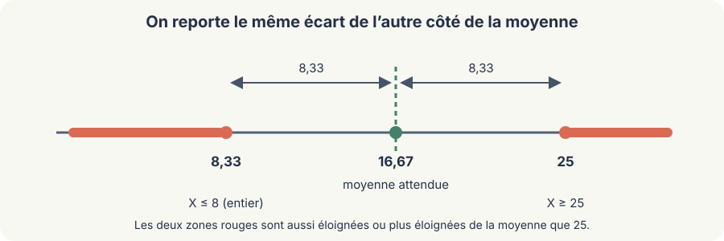

# Du dé à la p-value

**Une pratique avant les formules :** simuler ce qu'on pourrait observer si le dé était équilibré, puis situer notre résultat dans cette distribution.

---

## Une question concrète

On lance un dé 100 fois et on observe **25 six**. Est-ce surprenant ?

On commence par préciser ce qu'on teste :

- $H_0 : p_6=1/6$ — la probabilité d'obtenir un six est celle d'un dé équilibré ;
- $H_1 : p_6>1/6$ — on cherche spécifiquement un excès de six.

Sous $H_0$, le nombre moyen de six est $100/6\approx16{,}7$. Il ne doit pas forcément être égal à 17 dans chaque série.

**Limite du test :** vérifier $p_6=1/6$ ne suffit pas à prouver que les six faces sont toutes équiprobables. On ne teste ici que la fréquence des six.

---

## Pratique 1 · Simuler le dé équilibré

On simule 20 000 expériences de 100 lancers **sous $H_0$**. Chaque ligne du tableau représente une expérience ; on compte les six sur chaque ligne.

```python
import numpy as np

rng = np.random.default_rng(2026)
n_lancers = 100
n_simulations = 20_000

tirages = rng.integers(
    1, 7, size=(n_simulations, n_lancers), dtype=np.int8
)
resultats = (tirages == 6).sum(axis=1)

print("Moyenne simulée :", resultats.mean())
print("Écart-type simulé :", resultats.std())
```

La moyenne théorique est $100/6\approx16{,}7$ six ; l'écart-type théorique vaut $\sqrt{100\times(1/6)\times(5/6)}\approx3{,}73$.

---

## Pratique 2 · Une valeur exacte n'est pas une p-value

Dans les simulations, on peut estimer :

- $P(X=25)$ : la proportion d'expériences qui donnent exactement 25 six ;
- $P(X\geq25)$ : la proportion qui donnent 25 six **ou davantage**.

```python
six_observes = 25

p_exactement_25 = np.mean(resultats == six_observes)
p_unilaterale = np.mean(resultats >= six_observes)

print("P(X = 25), estimée :", p_exactement_25)
print("P(X >= 25), estimée :", p_unilaterale)
```

La p-value unilatérale est $P(X\geq25\mid H_0)$, ici estimée par **$P(X\geq25)$** dans nos simulations sous $H_0$. Elle additionne la probabilité de 25 et celles des résultats plus élevés : ce n'est pas $P(X=25)$ seul.

Pour repère, le calcul binomial exact donne environ **0,98 %** pour $P(X=25)$ et **2,17 %** pour $P(X\geq25)$. La simulation fournit une approximation qui varie légèrement d'une exécution à l'autre.

---

## Pourquoi choisir un seuil de 5 % ?

On fixe d'abord $\alpha=5\%$. C'est le taux maximal visé de **fausses alertes** : si $H_0$ est vraie et qu'on répète la même procédure, un test bien calibré rejette $H_0$ dans au plus 5 % des cas.

Ce seuil ne signifie **ni** que $H_0$ a 5 % de chances d'être vraie, **ni** que notre conclusion présente exactement 5 % de risque d'être fausse.

Pour le test unilatéral avec 25 six :

$$
p\text{-value}\approx2{,}17\% < 5\%.
$$

On rejette donc $H_0$ au seuil de 5 %, en faveur d'un excès de six. Avec cette loi discrète, le seuil réel de fausse alerte peut être inférieur à 5 % : on ne peut pas toujours atteindre exactement le seuil choisi.

---

## Pratique 3 · Une ou deux directions ?

Le choix dépend de la question posée **avant de regarder le résultat** :

- **Unilatéral :** $H_1:p_6>1/6$. Seuls les excès de six comptent ; pour 25 six, la p-value vaut environ **2,17 %**.
- **Bilatéral :** $H_1:p_6\ne1/6$. Un déficit ou un excès important compte. On part du résultat observé :

$$
25-\frac{100}{6}\approx8{,}33.
$$

Le signe positif indique que 25 est **8,33 au-dessus** de la moyenne attendue. Pour chercher un résultat aussi éloigné dans l'autre sens, on reporte la même distance sous la moyenne :

$$
\frac{100}{6}-8{,}33\approx8{,}33.
$$

Le nombre de six est entier : cela donne **8 six ou moins**. Du côté supérieur, on garde **25 six ou plus**. On additionne donc les probabilités des deux zones :



Soustraire la moyenne, $X-100/6$, exprime l'écart autour de zéro. La valeur absolue, $|X-100/6|$, mesure cet écart sans distinguer excès et déficit :

$$
p_{\mathrm{bilat}}=P\!\left(\left|X-\frac{100}{6}\right|\geq\left|25-\frac{100}{6}\right|\right)=P(X\leq8)+P(X\geq25)\approx3{,}12\%.
$$

Les deux p-values sont sous 5 % pour 25 six. Mais avec **24 six**, elles sont environ **3,79 %** en unilatéral et **5,92 %** en bilatéral : la conclusion au seuil de 5 % change. Il faut donc choisir la direction avant l'expérience.

---

## Visualiser les résultats comptés

On colorie en rouge les résultats inclus dans chaque p-value : à droite pour le test unilatéral ; des deux côtés pour le test bilatéral.

```python
import matplotlib.pyplot as plt

x = np.arange(n_lancers + 1)
probas = np.bincount(resultats, minlength=n_lancers + 1) / n_simulations
moyenne = n_lancers / 6
distance = abs(six_observes - moyenne)

unilaterale = x >= six_observes
bilaterale = np.abs(x - moyenne) >= distance

fig, axes = plt.subplots(1, 2, figsize=(12, 4))
for ax, masque, titre in [
    (axes[0], unilaterale, "Unilatéral : X ≥ 25"),
    (axes[1], bilaterale, "Bilatéral : résultats aussi éloignés"),
]:
    couleurs = np.where(masque, "tomato", "steelblue")
    ax.bar(x, probas, color=couleurs)
    ax.axvline(moyenne, color="green", linestyle="--", label="Moyenne sous H₀")
    ax.axvline(six_observes, color="black", linestyle=":", label="25 six observés")
    ax.set(xlim=(0, 40), xlabel="Nombre de six sur 100", ylabel="Probabilité simulée", title=titre)
    ax.legend()
fig.tight_layout()
plt.show()
```

---

## Ce qu'une petite p-value permet de dire

Une petite p-value indique que le résultat observé — ou un résultat plus extrême selon le test choisi — est rare **si $H_0$ et les hypothèses du modèle sont vraies**.

Elle ne donne pas la probabilité que $H_0$ soit vraie. Et ne pas rejeter $H_0$ ne prouve pas que le dé est équilibré : cela signifie seulement que les données ne suffisent pas à l'écarter avec ce test.

Les p-values données par simulation sont des estimations. Augmenter `n_simulations` les stabilise ; près du seuil de 5 %, il faut éviter de conclure à partir d'une simulation trop courte.

---

## À vous · Faire varier l'observation

1. Reprendre le code avec **24 six**. Comparer les p-values unilatérale et bilatérale au seuil de 5 %.
2. Recommencer avec 5 000 puis 100 000 simulations. Les estimations changent-elles ? La conclusion reste-t-elle claire ?
3. Pourquoi cette expérience ne prouve-t-elle pas que les six faces du dé ont toutes la même probabilité ?

<details><summary>Afficher une correction possible</summary>

Pour 24 six, le test unilatéral cherche seulement les résultats $X\geq24$ et donne environ **3,79 %** : on rejette $H_0$ au seuil de 5 %. Le test bilatéral compte aussi les résultats suffisamment éloignés de la moyenne du côté inférieur ; sa p-value vaut environ **5,92 %** : on ne rejette pas $H_0$ à ce seuil.

La simulation donne des valeurs proches, pas identiques, car elle ne réalise qu'un nombre fini d'expériences. Le test ne porte que sur la probabilité d'obtenir un six ; les autres faces ne sont pas comparées entre elles.

</details>

---

## Prolongement · Quand la loi est symétrique

Le nombre de six suit ici une loi binomiale qui n'est pas exactement symétrique. Pour une loi symétrique autour de 0, comme la loi normale centrée réduite, les deux côtés ont la même probabilité :

$$
P(|Z|\geq|z_{\mathrm{obs}}|)=2P(Z\geq|z_{\mathrm{obs}}|).
$$

Nous réutiliserons cette idée avec une loi symétrique : un test bilatéral examine alors deux queues de même aire.
